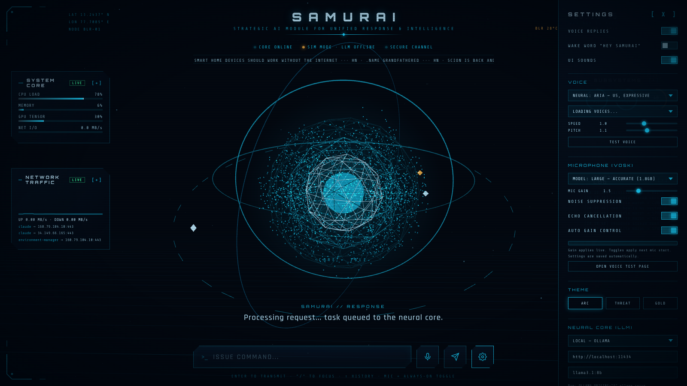

# SAMURAI — Jarvis-style local AI assistant

| # | Area | What it does |
|---|------|--------------|
| 1 | LLM status pill | Shows the active brain: Ollama (local), OpenAI, Claude or Gemini. Falls back to SIM MODE when none is reachable. |
| 2 | Live ticker | Crypto prices and Hacker News headlines. |
| 3 | Clock / weather | Local time, date and live weather (Open-Meteo). |
| 4 | System core | CPU, RAM, GPU and network load from the telemetry sidecar on port 8765. |
| 5 | Network traffic | Throughput graph and active TCP connections by process. |
| 6 | Event log | Service events plus recent Windows event-log entries. |
| 7 | Particle core | 3D core whose shape and state follow idle / listening / responding. |
| 8 | Response | SAMURAI's reply, typed on screen and spoken aloud. |
| 9 | Command input | Type a command, or press `/` to focus. |
| 10 | Mic | Streams microphone audio to the offline Vosk speech server on port 9100. |
| 11 | Settings | LLM provider and key, voices, speech model, mood and humor, PC control. |

Settings drawer:

Install and run instructions are in [README.txt](README.txt).
