# SAMURAI — Jarvis-style local AI assistant

A voice-driven assistant that runs on your own PC: an offline speech stack, a cinematic HUD with twelve live widgets, PC control, and any AI brain you like, from a local Ollama model to Claude, GPT, Gemini, Groq and a dozen more, or the Claude Code / Gemini CLI signed in with your normal plan and no API key.

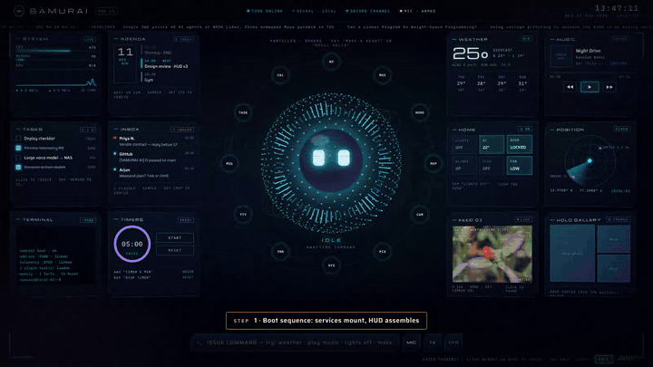

Half a minute of the recorded tour.

| Holographic desk, paper skin | Desk, glass skin | Desk, wireframe skin |
|---|---|---|
| 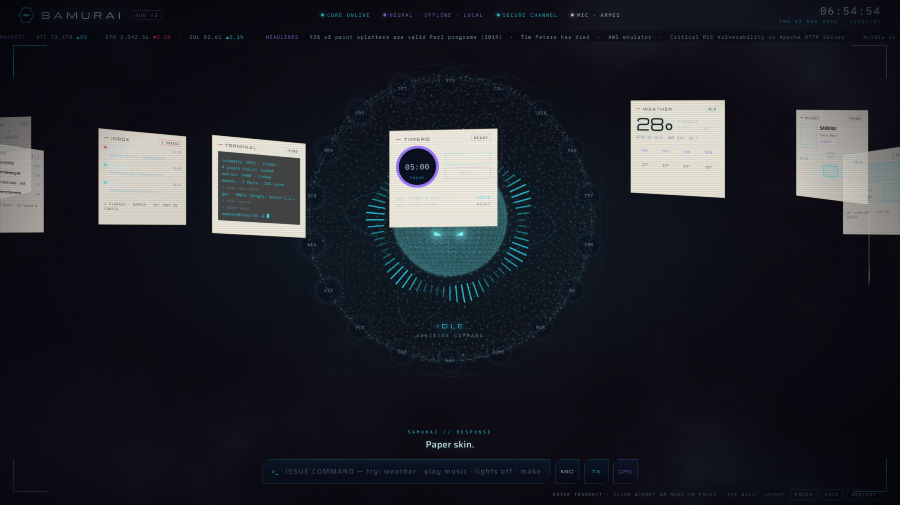 | 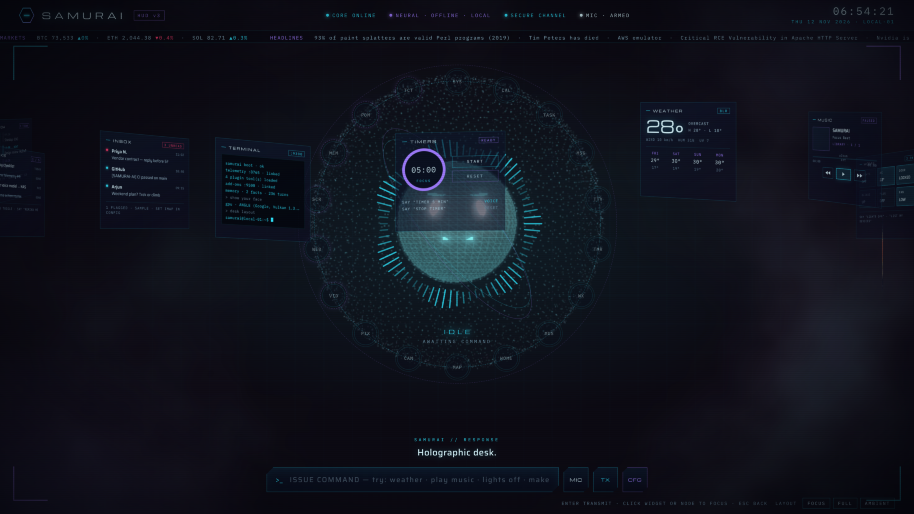 | 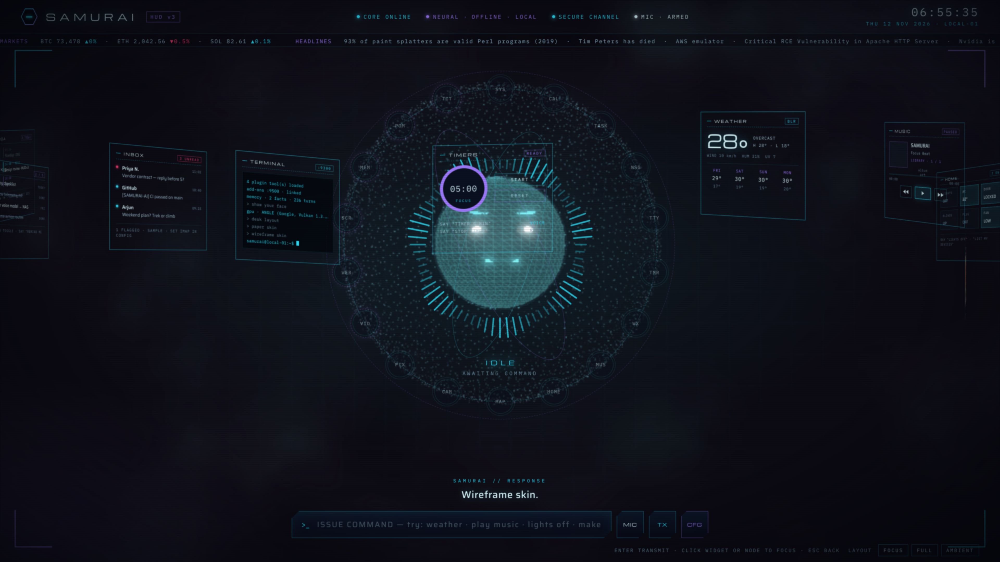 |
| Face avatar in the focus layout (now a pinu-bot robot face or a VRM character, see docs/FEATURES.md) | Wall mode | Mic kill switch |
| 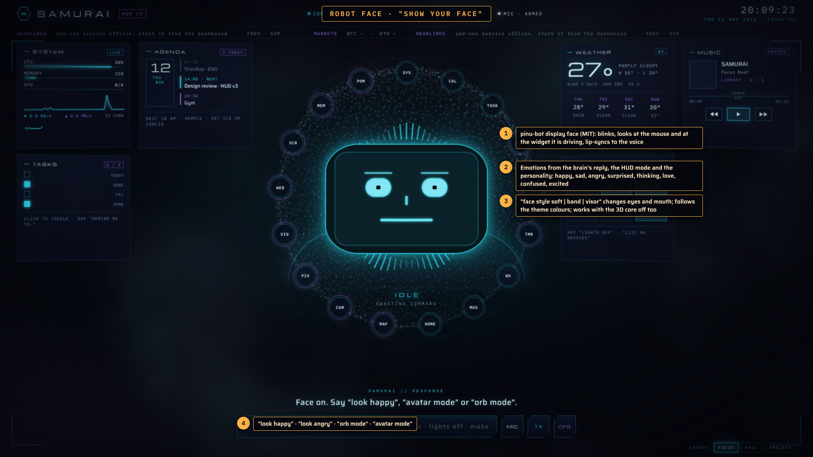 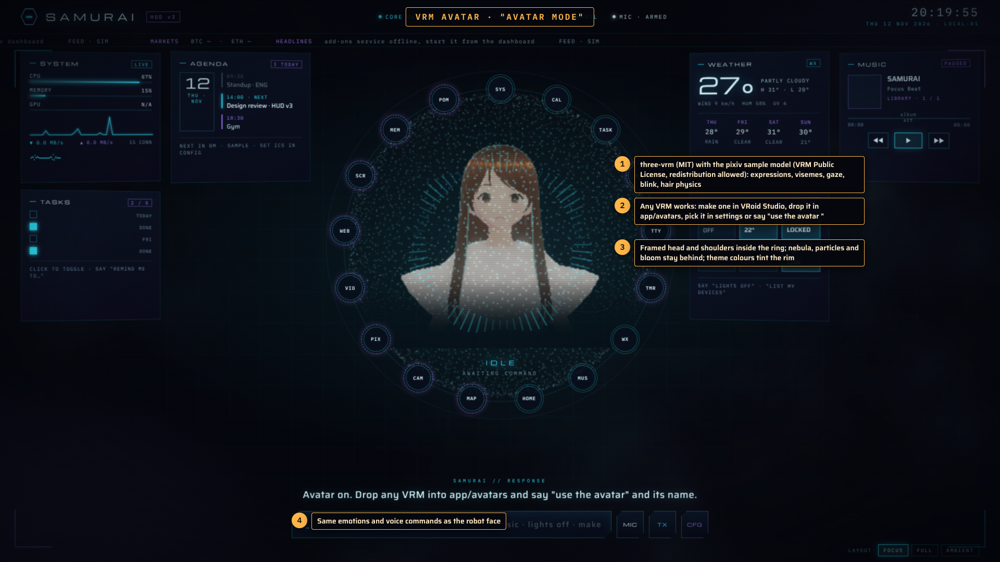 | 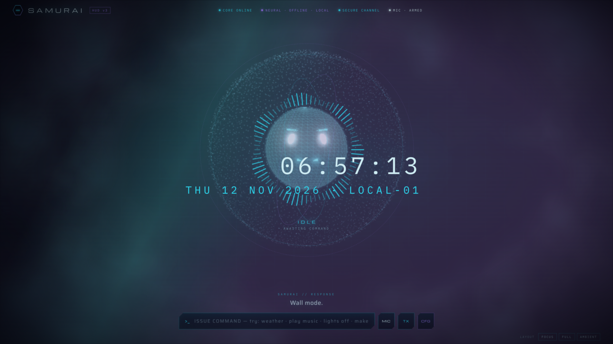 | 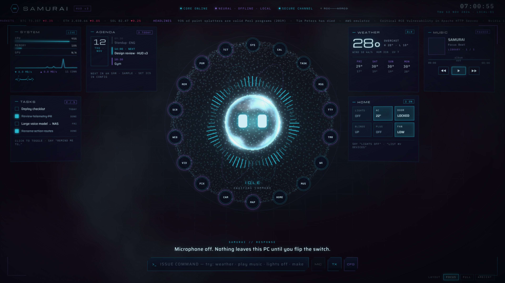 |
 **What's new in 1.6** (three minutes, 1080p, spoken commands): [docs/whatsnew-1.6.mp4](docs/whatsnew-1.6.mp4) shows the 3D face, the holographic desk, skins, the plugin store, rooms, the cost meter, a notification read aloud and the mic kill switch. **1.6** also adds Claude tools (MCP), missions, a cost meter, live two-way voice, voice identity, meeting mode, quiet mode during calls, notifications read aloud, faces and hand gestures, downloads, price watch, Hue / Govee / Kasa, rooms, settings sync, a plugin store, lyrics, a 3D face avatar and holographic desk / wall layouts (see [docs/FEATURES.md](docs/FEATURES.md)). **What's new in 1.5** (two and a half minutes, 1080p): [docs/whatsnew-1.5.mp4](docs/whatsnew-1.5.mp4) shows the map, calendar writes, the memory constellation, a widget designed by the brain, big text and the phone ringing. **The full tour**: [docs/walkthrough-ultimate.mp4](docs/walkthrough-ultimate.mp4) (v6, 1080p, four and a half minutes) shows the 3D core, video and the live browser inside the HUD, music, themes and looks, the alert, the journal, focus sessions, cleanup and a command sent from the phone. **With sound**: [docs/walkthrough-voice.mp4](docs/walkthrough-voice.mp4) is a three-minute spoken walkthrough where eleven commands are said into the microphone, recognised offline, and answered in SAMURAI's own voice, with a narrator: weather, shapes, timer, smart home, a reminder, document search, plan mode, a proactive check, layouts, the alert, the ring, settings, LAN mode and the control panel. [docs/walkthrough-motion.mp4](docs/walkthrough-motion.mp4) is a second spoken video (1080p) about the avatar: free roaming across the screen while idle, bouncing to a song from the library, colour themes by voice, particle shapes and spelled words, and "stay still" / "roam". The silent captioned version is [docs/walkthrough.mp4](docs/walkthrough.mp4) and the step-by-step guide is [docs/WALKTHROUGH.md](docs/WALKTHROUGH.md).

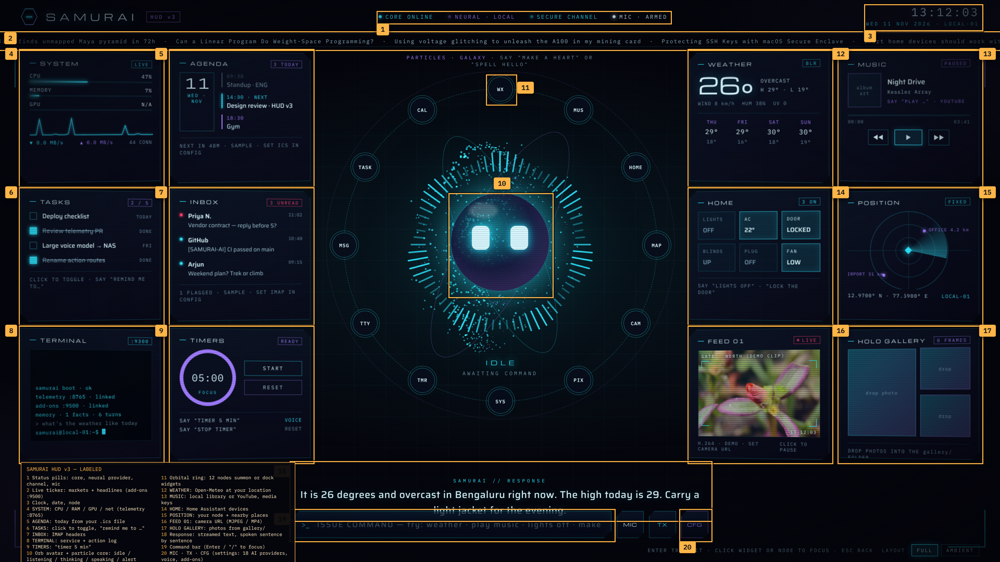

| # | Area | What it does |
|---|------|--------------|
| 1 | Status pills | Core, which neural provider is active, secure channel, mic state. |
| 2 | Live ticker | Crypto prices and headlines from the add-ons service. |
| 3 | Clock | Time, date and your node label. |
| 4 | SYSTEM | CPU, RAM, GPU, network sparkline and connection count from the telemetry service. |
| 5 | AGENDA | Today's events from an `.ics` calendar file. |
| 6 | TASKS | Persistent task list. Click to toggle, or say "remind me to …". |
| 7 | INBOX | Latest mail headers over IMAP. |
| 8 | TERMINAL | Everything SAMURAI does: commands, actions, service events. |
| 9 | TIMERS | "timer 5 min", pause, reset, spoken when done. |
| 10 | Orb + particle core | The avatar. Eyes and the waveform ring change with idle, listening, thinking, speaking and alert. The particle field morphs: "make a heart", "spell hello". |
| 11 | Orbital ring | Twelve nodes. Click one to fly its widget to the centre; unpinned widgets dock here. |
| 12 | WEATHER | Open-Meteo for your location, no key needed. |
| 13 | MUSIC | Your music folder, or YouTube through the action service, plus system media keys. |
| 14 | HOME | Home Assistant devices, or a local sample you can toggle. |
| 15 | POSITION | Radar with your node and nearby places. |
| 16 | FEED 01 | A camera URL (MJPEG, MP4 or HLS). |
| 17 | HOLO GALLERY | Photos dropped into the `gallery/` folder. |
| 18 | Response | The reply types in as it streams and is spoken sentence by sentence. |
| 19 | Command bar | Type, or press `/` to focus. |
| 20 | MIC · TX · CFG | Voice input, transmit, settings drawer. |

Settings drawer, security alert, and the flow layout on a phone:

<p>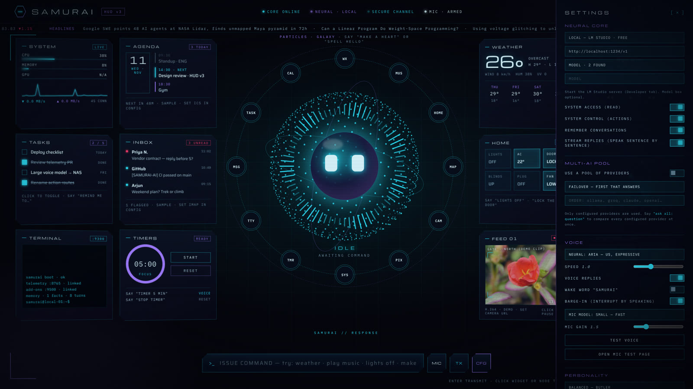 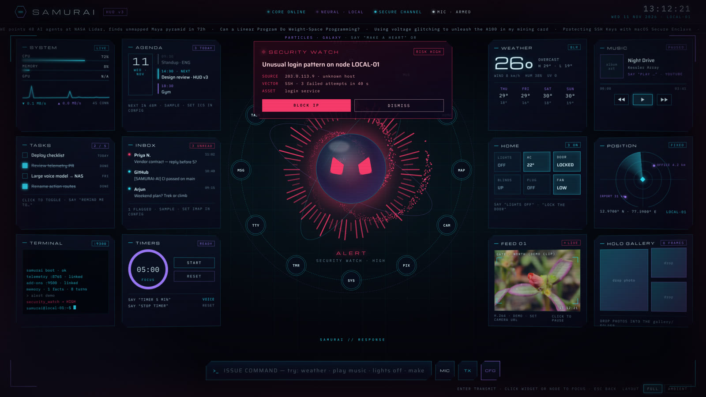</p>
<p>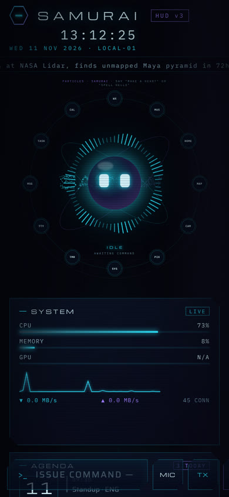 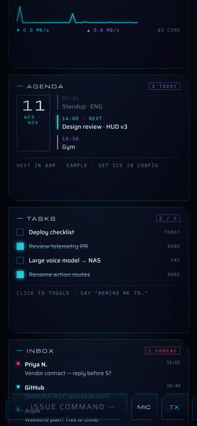 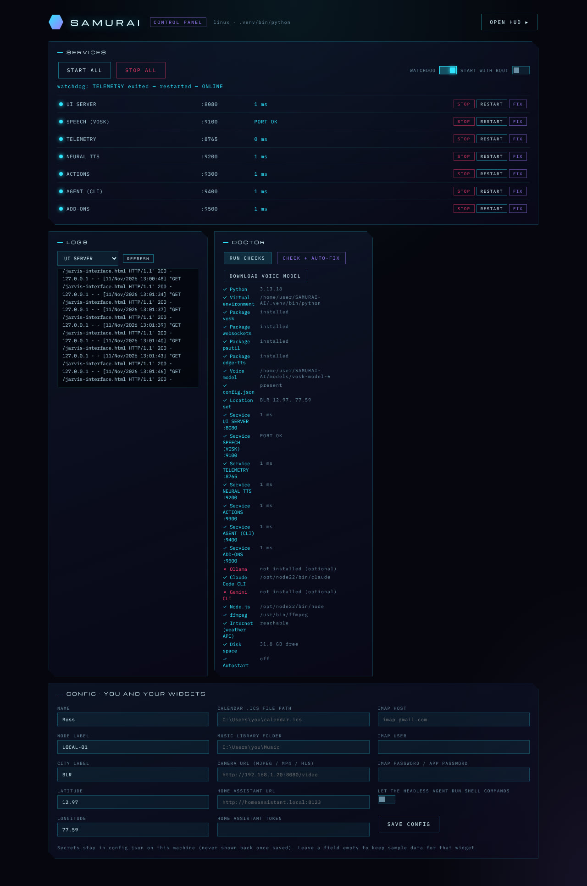</p>

## Download the packaged build (no Python needed)

Every push builds **SAMURAI.exe** for Windows and a Linux build with PyInstaller (`.github/workflows/build-exe.yml`). Open the repository's **Actions** tab, pick the latest `build-exe` run, and download `SAMURAI-windows-x64.zip` from its Artifacts. Unzip anywhere and run `SAMURAI.exe`: it creates `config.json`, `data/`, `logs/` and `models/` next to itself, downloads the voice model on first run, starts every service and opens the HUD. Tags like `v1.0` also publish the zips on a GitHub Release. The packaged build was verified here on Linux (all eight services supervised from the single executable); the Windows build runs on the Windows runner.

## Install from source

Windows: install Python 3.9+ from python.org (tick "Add Python to PATH"), then double-click `SETUP.bat`.

Linux and macOS:

```bash
./install.sh
```

The installer creates `.venv`, installs the requirements, downloads the 40 MB offline voice model, writes `config.json`, offers the headless agent CLIs, a desktop shortcut and start-with-boot, runs a 24-point health check, and starts everything. Afterwards use `START.bat` or `./install.sh --start`, or open the control panel at `http://localhost:9000`.

## How it is put together

| Piece | Port | Role |
|---|---|---|
| `app/jarvis-interface.html` + `app/js/*` | 8080 | The HUD. Plain HTML, CSS and JavaScript, no build step. |
| `servers/samurai_panel.py` + `app/panel.html` | 9000 | Control panel and supervisor: start/stop/restart, logs, watchdog, doctor with auto-fix, autostart, config editor, optional voice engines. |
| `servers/samurai_telemetry.py` | 8765 | CPU, memory, GPU, network, processes, disks, battery, system log. |
| `servers/samurai_speech_server.py` | 9100 | Offline speech recognition (Vosk) over WebSocket, voice-activity gate, optional wake-word engine. |
| `servers/samurai_tts_server.py` | 9200 | Neural voice: Microsoft Edge voices online, or Kokoro fully local. |
| `servers/samurai_action_server.py` | 9300 | PC control on Windows, Linux and macOS: apps, URLs, music, volume, media keys, brightness, screenshot, clipboard, typing, hotkeys, lock, and confirmation-gated sleep, shutdown, restart, kill process and allow-listed commands. |
| `servers/samurai_agent_server.py` | 9400 | Headless Claude Code / Gemini CLI: chat, live web search, file tasks in `workspace/`. |
| `servers/samurai_addons.py` | 9500 | Widget data: config, weather, ticker, tasks, agenda, inbox, home, music, gallery, position, security watch with firewall block, memory, schedules, routines, events, document search, mail. |
| `servers/samurai_browser.py` | 9600 | Browser agent (Playwright Chromium) the brain can drive. |

Every sidecar answers only the SAMURAI pages' origin; other websites get 403. Nothing listens outside localhost.

## Brains

Pick a provider in CFG → NEURAL CORE. Local and free options are marked. TASK ROUTING can send chat, work, research and vision to different brains. The reply contract is JSON (`reply`, `focus`, `actions`, `shape`), so every provider can drive the widgets and the PC.

- **Local**: Ollama, LM Studio, llama.cpp, or any OpenAI-compatible server.
- **No API key**: Claude Code and Gemini CLI, run headless and signed in with your own plan. Install one, run `claude auth login` or `gemini` once, and pick the headless provider.
- **API keys**: OpenAI, Anthropic Claude, Google Gemini (free tier), OpenRouter, Groq (free tier), Mistral, DeepSeek, xAI Grok, Perplexity, Together, Hugging Face, Azure OpenAI.
- **Pool**: list several providers and choose failover or round-robin. Say "ask all: question" to hear what each configured provider answers.
- **Memory**: facts ("remember that …") and recent turns are stored locally by the add-ons service and fed into every prompt.
- **Streaming**: replies type in as they arrive and are spoken sentence by sentence. Speak to interrupt (barge-in).

Test without any AI: `python tests/mock_llm.py`, then choose LOCAL — LM STUDIO.

## Jarvis-style extras

- **A living avatar**: when idle the orb drifts on every axis, tilts, breathes and glances around, and snaps back to the centre the moment you speak. Switch it off under ORB WANDERS WHEN IDLE.
- **Focus layout** (default): six widgets on screen, six docked in the ring, less visual noise. "Full layout" shows all twelve, "ambient" hides everything but the core.
- **Plan mode**: "plan: get me ready for deep work". The brain breaks the goal into SAMURAI commands and runs them one by one.
- **Proactive check-ins**: a settings switch makes SAMURAI look at the live data every 30 minutes and speak only when something matters.
- **Memory recall**: related earlier conversations are pulled into the prompt automatically ("what did I ask about the vendor contract").
- **Forgiving wake word**: "damn ri", "some rye" and similar mishearings of "samurai" still wake it.
- **Phone / LAN mode**: a switch in the control panel binds the services to your network and prints a link with a token, so the HUD works from your phone on the same Wi-Fi. Without the token, requests from other machines get 403.

## Automation

- **Schedules**: "every day at 8 am say good morning", "every weekday at 9 run morning briefing", "every 30 minutes check my system", "remind me at 5 pm to call mom", "in 20 minutes remind me to stretch". Spoken when due.
- **Routines**: "focus mode", "good night", "good morning" run a list of commands. Edit them in `data/routines.json`.
- **Briefing**: "morning briefing" narrates weather, agenda, tasks, inbox and system health.
- **Proactive alerts**: CPU temperature, disk nearly full, battery low, memory full, a meeting in five minutes. SAMURAI speaks first.
- **Audit**: every action is logged; "what did you do today" reads it back. `actions.deny` and `actions.no_confirm` in `config.json` tune the permissions.
- **Plugins**: drop a Python file into `plugins/` (see `plugins/example_tools.py`) and its tools become actions the brain can call.
- **Documents**: set a folder in the control panel, then "search my documents for payment terms". Text, Markdown, PDF, Word and code files are indexed locally.

## Sight and hands

- **Vision**: "what is on my screen", "look at my screen and tell me the error", "what do you see" (webcam). Works with OpenAI, Claude, Gemini or an Ollama vision model; pick one under TASK ROUTING → VISION.
- **Browser agent**: a real Chromium the brain drives step by step: open, read, click, type, find. `pip install playwright && python -m playwright install chromium`; the control panel installs it on first use. Set "show the window" in the panel to watch it work.
- **Desktop agent**: "on my desktop, open the settings and turn on dark mode". Screenshot → vision brain → one click, keystroke or scroll at a time, with a CANCEL toast. Needs SYSTEM CONTROL on and a vision brain; on Linux install `xdotool`, on macOS `cliclick`.
- **Mail**: "send an email to … | subject | body" over SMTP, after confirmation.

## Voice

Vosk runs offline on CPU. The small model ships through the installer; the large one is optional. The server-side voice-activity gate skips silence, and the control panel can install the openWakeWord engine for a hands-free wake word, or the Kokoro engine for a fully local voice. Say "samurai …" with the wake-word toggle on, or just click MIC and talk.

## Tests

```bash
.venv/bin/python tests/smoke_sidecars.py
```

```bash
.venv/bin/python tests/voice_e2e.py
```

The first checks every route and the origin lock. The second synthesises a phrase, feeds it through the recogniser, and expects it back.

## Files

**Every feature in labeled screenshots: [docs/SCREENSHOTS.md](docs/SCREENSHOTS.md).** **Installing, step by step with screenshots: [docs/INSTALL.md](docs/INSTALL.md)** (Windows exe, source on any OS, the chromeless app window, phone pairing, updating, troubleshooting). `README.txt` has the plain-text version of this guide. `docs/CHECKLIST.md` tracks what was built and `docs/ROADMAP.md` lists everything that could still be added, numbered. `app/legacy-interface.html` is the previous interface. `samurai_dashboard.py` is the older tkinter dashboard for Windows; the browser control panel replaces it.

## How this was built

The whole project was built in one Claude Code session over two days. The complete chat is in [docs/SESSION.md](docs/SESSION.md), with the [context summaries](docs/session/context-summaries.md) (the shortest read of every decision), the [tool log](docs/session/tool-log.md) (every command, read, edit and agent launch) and the [background agent reports](docs/session/agent-reports.md). Stage-by-stage progress is in [docs/CHECKLIST.md](docs/CHECKLIST.md) and the 90-item plan in [docs/ROADMAP.md](docs/ROADMAP.md).
