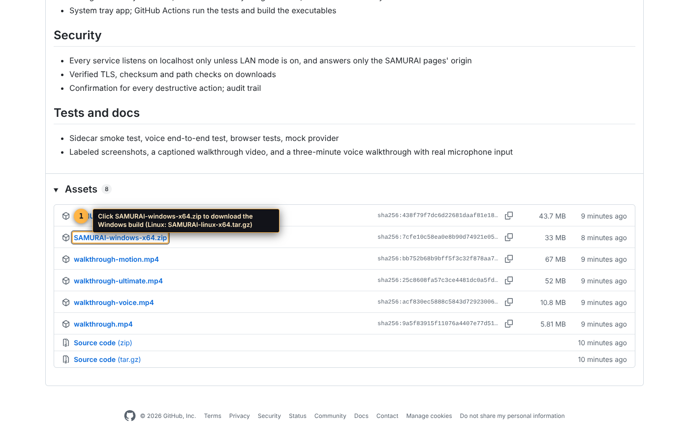
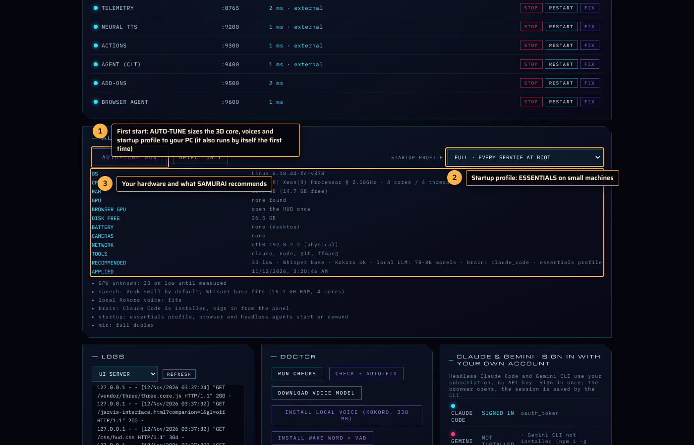
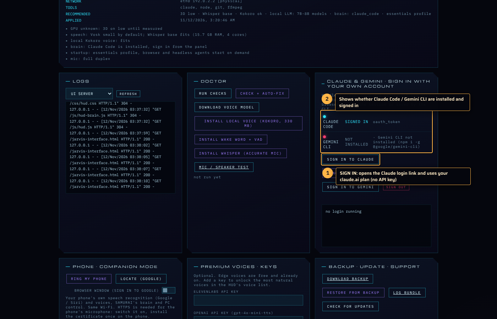
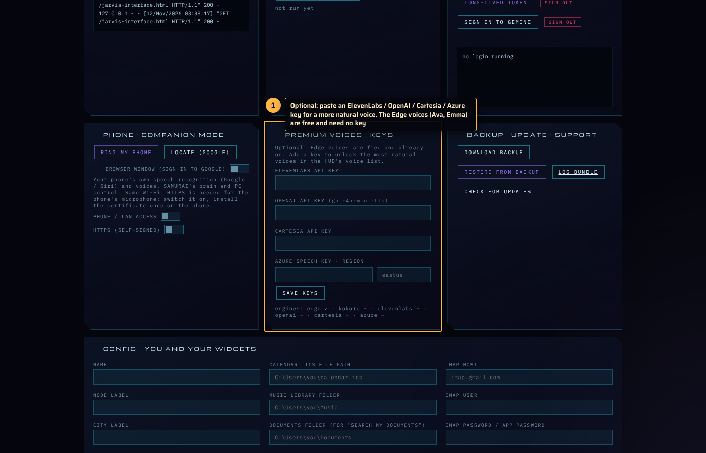
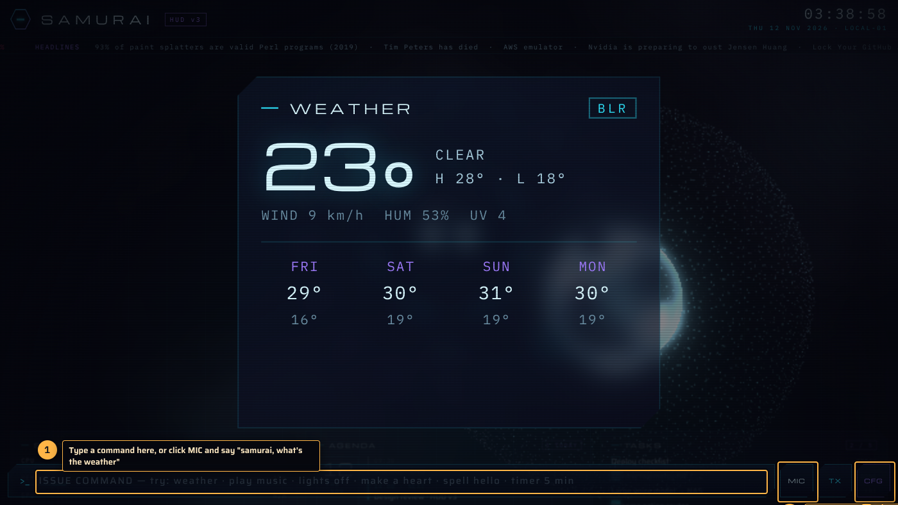
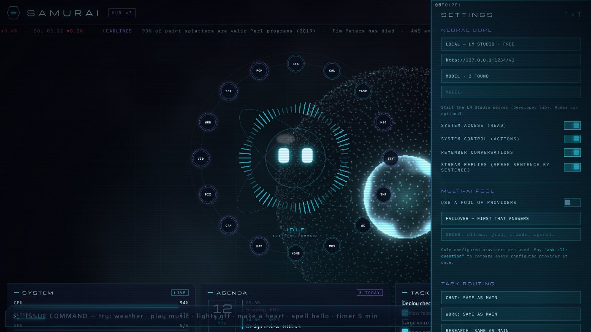
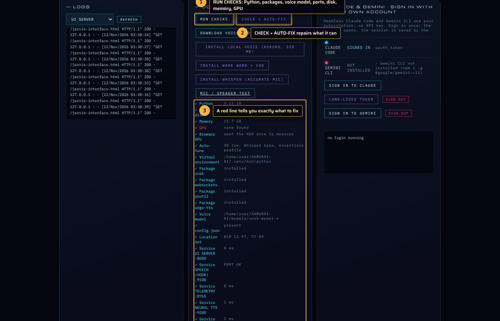
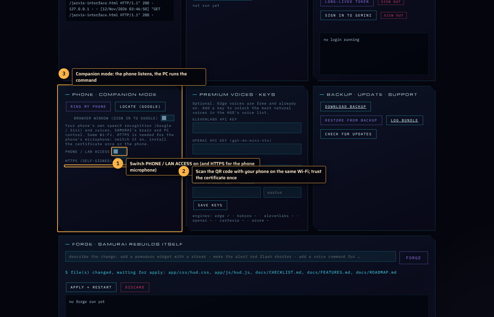

# Installing SAMURAI, step by step

Three ways to run it. Pick one.

| | Best for | Needs |
|---|---|---|
| **A. Windows exe** | most people | nothing, just unzip |
| **B. From source** | Linux, macOS, developers, the self-building "forge" | Python 3.9+ |
| **C. App window** | a chromeless window instead of a browser tab | A or B, plus one package |

Every screenshot below was taken from the real build. The numbered badges match the steps.

---

## A. Windows: the exe

From v1.5.0 there is also `SAMURAI-setup-<version>.exe` on the release page: a normal installer (per-user, no admin) with Start Menu entries and an optional "start with Windows" box. The zip below still works if you prefer a portable folder.


### 1. Download

Open the latest release page: **https://github.com/sxi9/SAMURAI-AI/releases/latest**. Scroll to **Assets** and click `SAMURAI-windows-x64.zip`.



### 2. Unzip and run

1. Right-click the zip, **Extract All**, choose a folder such as `C:\SAMURAI`. Do not run it from inside the zip.
2. Double-click **`SAMURAI.exe`**.
3. Windows SmartScreen shows "Windows protected your PC" once, because the exe is not code-signed. Click **More info**, then **Run anyway**.
4. A terminal window stays open (that is SAMURAI's supervisor; minimise it, do not close it). Your browser opens the control panel at `http://localhost:9000` and the HUD at `http://localhost:8080`.

The first start downloads the small offline voice model (about 50 MB) and creates `config.json`, `data\`, `logs\` and `models\` next to the exe.

### 3. First start: auto-tune

The control panel reads your CPU, memory, GPU, battery, cameras and network and sets the 3D quality, voice models and startup profile for your machine. It runs by itself the first time; press **AUTO-TUNE NOW** whenever you change hardware.



On a laptop with two GPUs the panel warns you if the browser is running on the slow integrated one. Fix: Windows **Settings → System → Display → Graphics**, add your browser, set it to **High performance**.

### 4. Sign in to Claude (or pick another brain)

SAMURAI needs an AI "brain". The easiest with no API key is your own claude.ai plan through Claude Code:

1. In the panel, card **CLAUDE & GEMINI**, click **SIGN IN TO CLAUDE**.
2. A link appears; open it, sign in, come back. The row turns green: *signed in*.



Alternatives, set in the HUD settings (CFG): any local model (Ollama, LM Studio), or an API key for OpenAI, Anthropic, Gemini, Groq, OpenRouter and ten more.

### 5. Voice (optional)

The free Edge voices (Ava, Emma, Aria) work out of the box. For a more natural voice paste a key from ElevenLabs, OpenAI, Cartesia or Azure in the **PREMIUM VOICES** card, then pick the voice in the HUD settings.



### 6. Your first command

Open the HUD (**OPEN HUD** button). Type `what's the weather` in the command bar, or click **MIC**, allow the microphone once, and say *"samurai, what's the weather"*.



### 7. Settings

**CFG** opens the settings drawer: brain, voice, mic, personality, pinned widgets, theme, 3D core quality, effects, presence camera.



### 8. If something is off: the doctor

Panel → **DOCTOR → RUN CHECKS**. Every line is a check (Python, packages, voice model, ports, disk, memory, GPU, browser GPU). **CHECK + AUTO-FIX** repairs what it can.



---

## B. From source (Windows, Linux, macOS)

1. Install Python 3.9 or newer (Windows: tick *Add python to PATH* in the installer). Optional: Node.js for Claude Code / Gemini CLI, Git.
2. Get the code:
   ```bash
   git clone https://github.com/sxi9/SAMURAI-AI.git
   cd SAMURAI-AI
   ```
   or download the ZIP from the repository page and unzip it.
3. Run the installer. It creates `.venv`, installs the packages, downloads the voice model, writes `config.json`, offers shortcuts and autostart, and starts everything:
   - Windows: double-click **`SETUP.bat`** (later starts: **`START.bat`**)
   - Linux / macOS:
     ```bash
     ./install.sh
     ```
   - or on any OS:
     ```bash
     python install.py
     ```
4. Continue with steps 3 to 8 above. The panel is at `http://localhost:9000`.

Later starts from source: `python samurai_launcher.py` (or `START.bat`).

---

## C. The app window (no browser)

SAMURAI can run the HUD in its own chromeless window instead of a browser tab: no address bar, remembers its size and place, optional always-on-top, **Ctrl+Alt+S** brings it to the front.

- **Exe:** run `SAMURAI.exe --window` (make a shortcut with that argument), or press **OPEN AS APP WINDOW** in the control panel.
- **Source:** `python samurai_launcher.py --window`, or the same panel button. The installer tries to add the `pywebview` package; if it was skipped, run `.venv\Scripts\pip install pywebview` (Windows) or `.venv/bin/pip install pywebview`.

The window uses Edge WebView2 on Windows (already present on Windows 10/11), WebKit on macOS, GTK WebKit on Linux (`sudo apt install python3-gi gir1.2-webkit2-4.1` on Debian/Ubuntu). Without it, the button simply opens the HUD in your browser.

---

## Phone companion mode

Your phone can be the microphone and speaker; the PC runs the commands.

1. Panel → **PHONE · COMPANION MODE** → switch **PHONE / LAN ACCESS** on. Switch **HTTPS** on too: phones only allow the microphone on a secure page.
2. Scan the QR code with the phone (same Wi-Fi). Several addresses may be listed if you have VMware or VirtualBox adapters; the Wi-Fi one is first.
3. Trust the certificate once, because it is self-signed:
   - **Android (Chrome):** the first visit shows "Your connection is not private" → **Advanced → Proceed**. For a permanent fix open the panel's **certificate** link on the phone, save `samurai.crt`, then *Settings → Security → Encryption & credentials → Install a certificate → CA certificate*.
   - **iPhone (Safari):** open the panel's **certificate** link, allow the profile, then *Settings → General → VPN & Device Management → install*, and *Settings → General → About → Certificate Trust Settings → enable*.
4. On the phone page, allow the microphone. In the HUD settings choose who speaks the reply: phone, PC or both.



---

## Where things live

- `config.json` next to the exe (or in the source folder): your name, location, widget sources, keys that are not in the keychain. The panel's **CONFIG** card edits it.
- `data\`: memory, journal, tasks, routines, schedules, certificates, window position.
- `logs\`: one log per service; **LOG BUNDLE** in the panel zips them for support.
- `models\`: voice models.

## Updating

Download the new zip and extract it over the old folder (or `git pull` for source and run `python install.py` again). `config.json`, `data\`, `logs\` and `models\` are kept. The panel's **CHECK FOR UPDATES** tells you when a newer release exists.

## Uninstalling

1. Panel → switch **START WITH BOOT** off (removes the autostart entry).
2. Close SAMURAI and delete the folder. Nothing is written elsewhere, except an optional keychain entry per API key and the autostart entry removed in step 1.

## Troubleshooting

| Problem | What to do |
|---|---|
| "Port already in use" / a service stays red | Something else uses 8080, 8765, 9000, 9100, 9200, 9300, 9400, 9500 or 9600. Close it, or press **CHECK + AUTO-FIX**. |
| No microphone | The browser must be allowed to use the mic (lock icon in the address bar). Use the panel's **MIC / SPEAKER TEST**. On a phone the page must be https. |
| No sound | Click the page once (browsers block audio before the first click). Check the HUD settings → VOICE REPLIES is on; **TEST VOICE**. Edge voices need internet; Kokoro works offline. |
| 3D core slow or stuttering | Run **AUTO-TUNE NOW**; set 3D CORE to LOW in the HUD settings, or say *"3d off"* for the 2D core. On a two-GPU laptop put the browser on the discrete GPU (step 3). |
| SmartScreen blocks the exe | More info → Run anyway. The release page shows the file's SHA-256 so you can verify it. |
| Brain says "offline" | Sign in to Claude in the panel, or set a provider and key in the HUD settings. The offline router still answers weather, lights, timers and tasks. |
| Phone cannot connect | Same Wi-Fi? Firewall: allow the ports above (the installer adds a rule on Windows). Try the Wi-Fi address from the list, not a VMware one. |

Still stuck: panel → **LOG BUNDLE**, and open an issue with the zip attached.
