# SAMURAI walkthrough

A recorded tour of the HUD and the control panel. **[walkthrough-voice.mp4](walkthrough-voice.mp4)** (v2, three minutes, includes plan mode, proactive check-ins, focus layout and LAN mode) is the version with sound: a synthesized user voice is played into the browser's microphone, the offline Vosk recogniser hears it, and SAMURAI replies with its Edge neural voice; a narrator explains each part. The user voice, the replies, the chimes and the alert buzz are all real output of the services; only the mixing was done afterwards because a headless browser has no speakers. Every step below is a frame from the recording, captioned in the frame itself. The full recording is [walkthrough.mp4](walkthrough.mp4) (about two minutes); the gif in the README is the first forty seconds.

The tour runs against the mock AI provider (`python tests/mock_llm.py`), so the replies are canned. With a real brain the same commands produce real answers.

## 1. Boot and idle

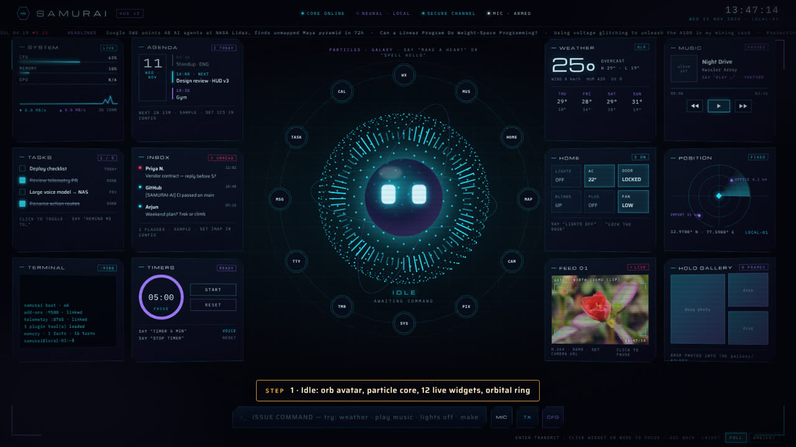

The boot overlay mounts the services, then the twelve widgets fly in from the core. Idle state: the orb blinks, the particle field cycles through shapes every nine seconds, telemetry updates every two seconds.

## 2. Ask something

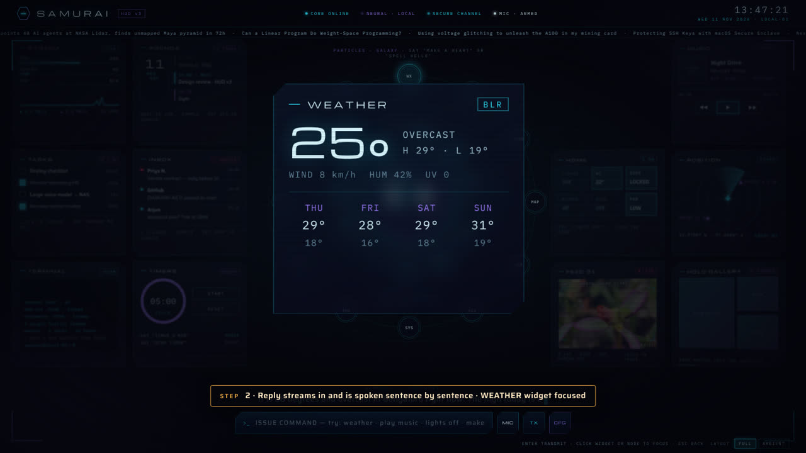

"What's the weather like today." The reply streams in and is spoken sentence by sentence while the WEATHER widget flies to the centre. The brain returned `{"reply", "focus": "wx"}`.

## 3. Shape the core

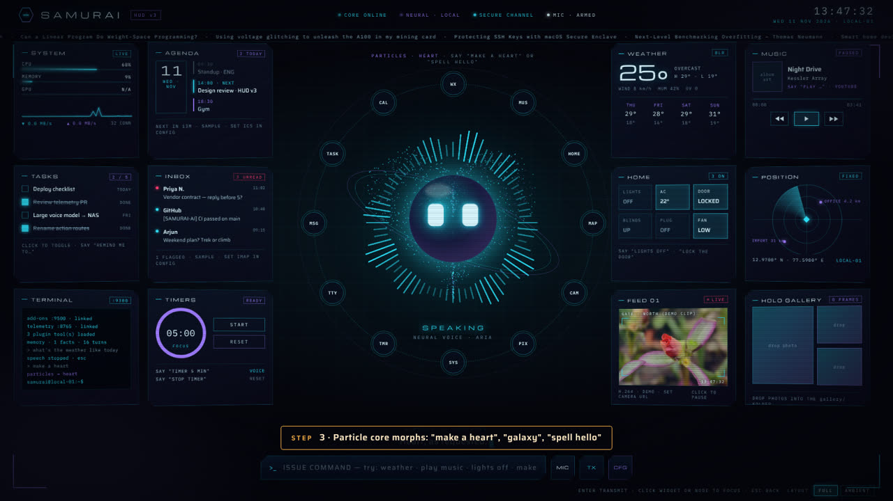

"Make a heart." Also galaxy, cube, helix, knot, ring, wave, sphere, or "spell hello".

## 4. Timers

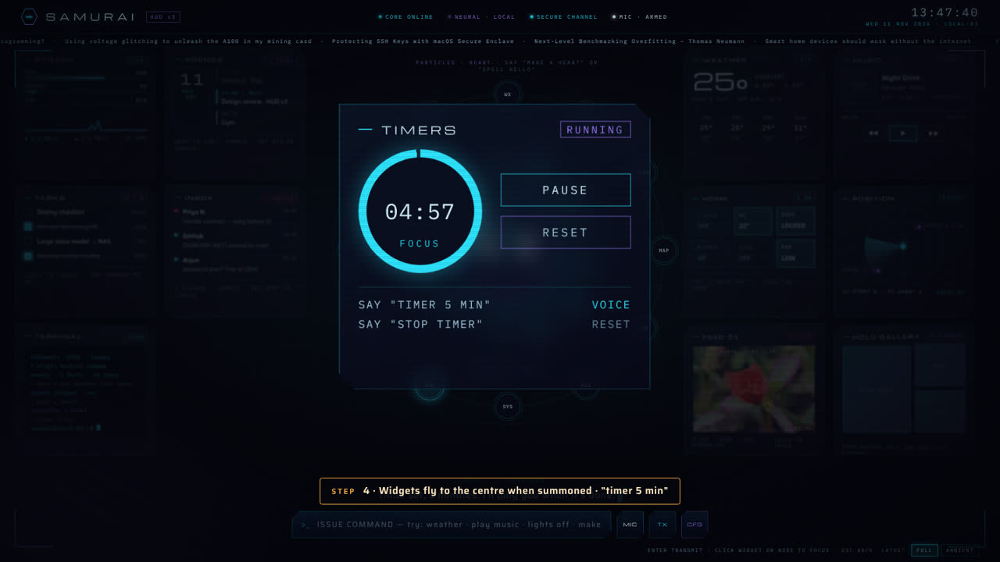

"Timer 5 min." The TIMERS widget is summoned and starts counting; SAMURAI speaks when it ends.

## 5. Smart home

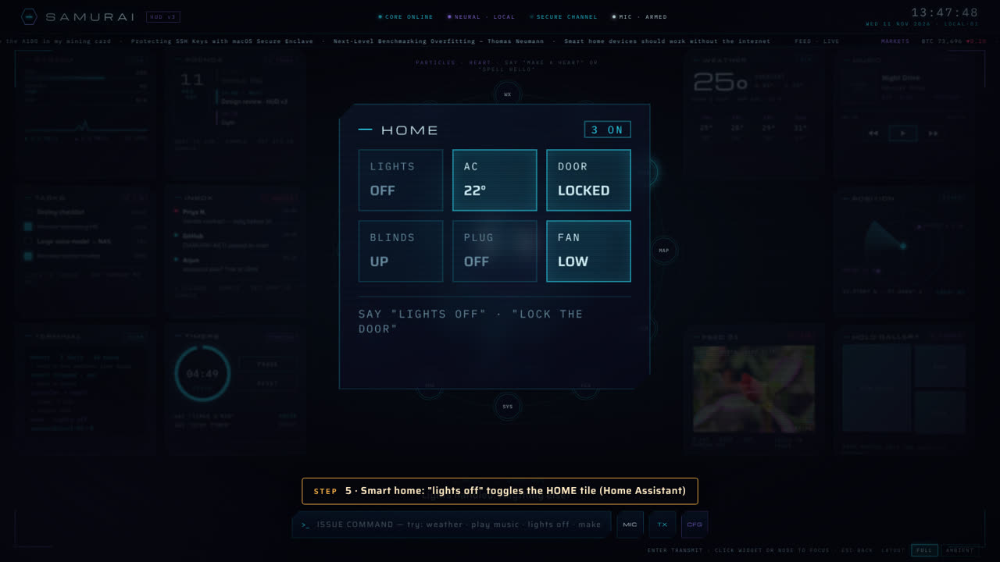

"Lights off." The HOME tile toggles. With Home Assistant configured the real device switches.

## 6. Schedules

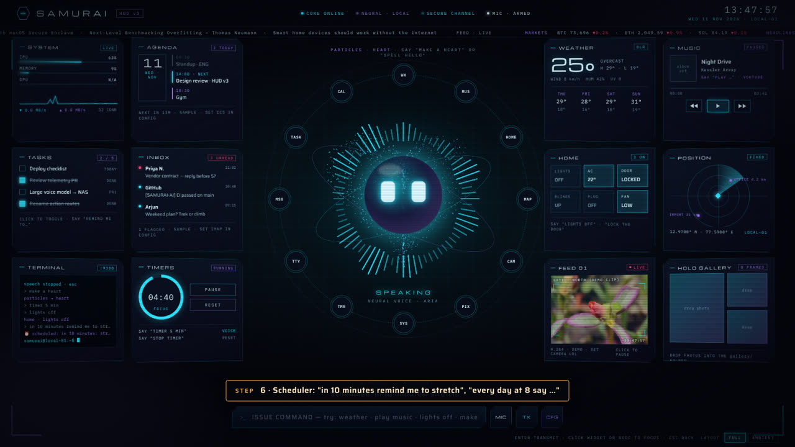

"In 10 minutes remind me to stretch." Also "every day at 8 am say good morning", "every weekday at 9 run morning briefing", "remind me at 5 pm to call mom". Reminders are spoken when due, even if you said nothing since.

## 7. Audit

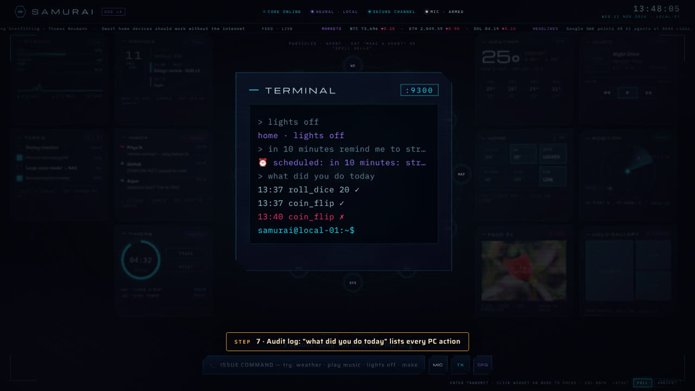

"What did you do today." Every PC action is logged and summarised.

## 8. The orbital ring

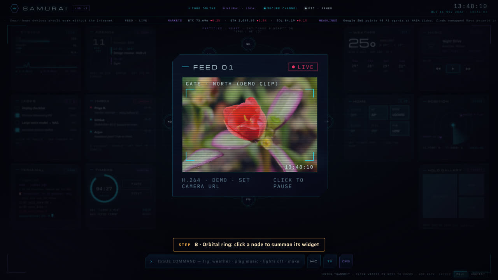

Click a ring node to summon its widget. Unpinned widgets dock here.

## 9. Settings

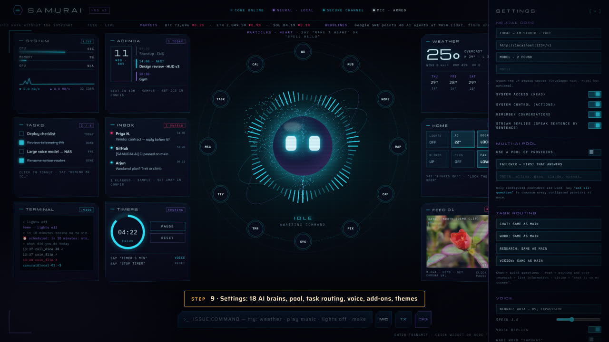

Eighteen brains, a provider pool, task routing, voice, wake word, mic model, personality, pinned add-ons, layout, themes, your name and location.

## 10. Themes

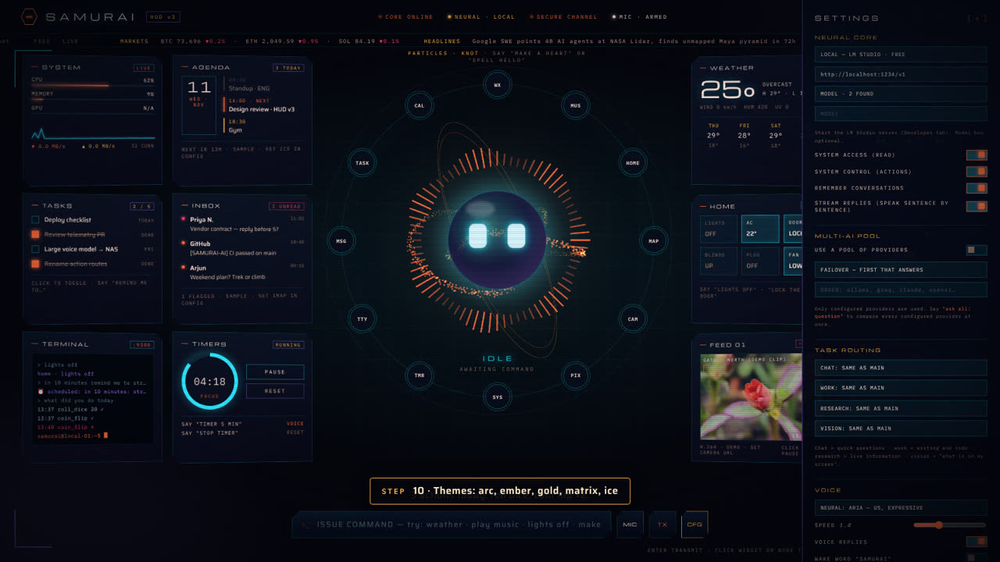

Arc, ember, gold, matrix, ice. The canvas and the eyes follow the theme.

## 11. Security watch

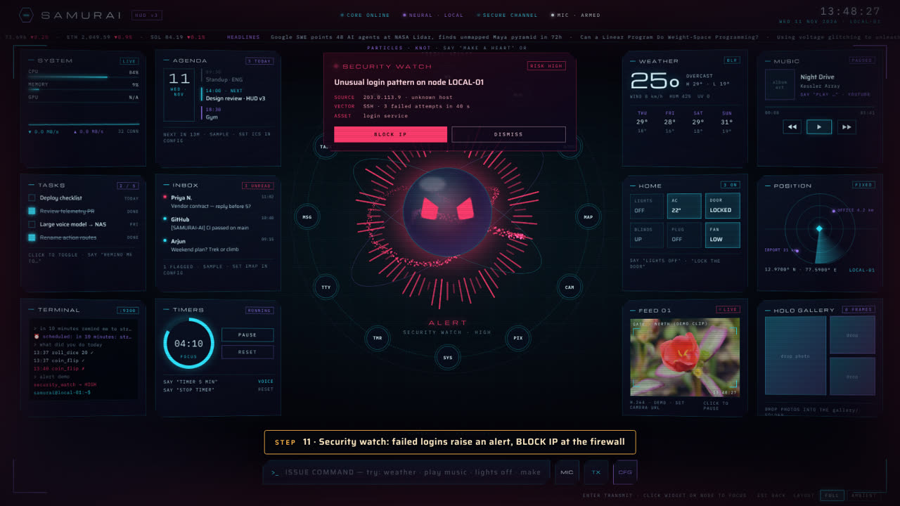

Repeated failed logins raise an alert. BLOCK IP adds a firewall rule; DISMISS clears it.

## 12. Ambient layout

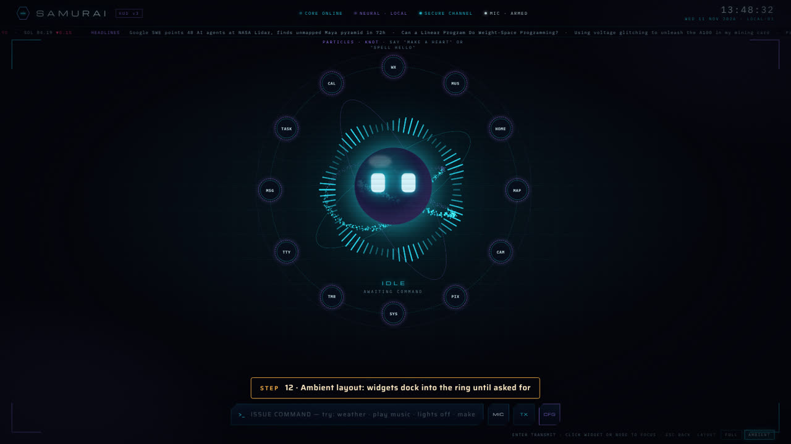

"Ambient." Only the core, the ring and the console remain. Ask for a widget and it flies in from its node.

## 13. Control panel

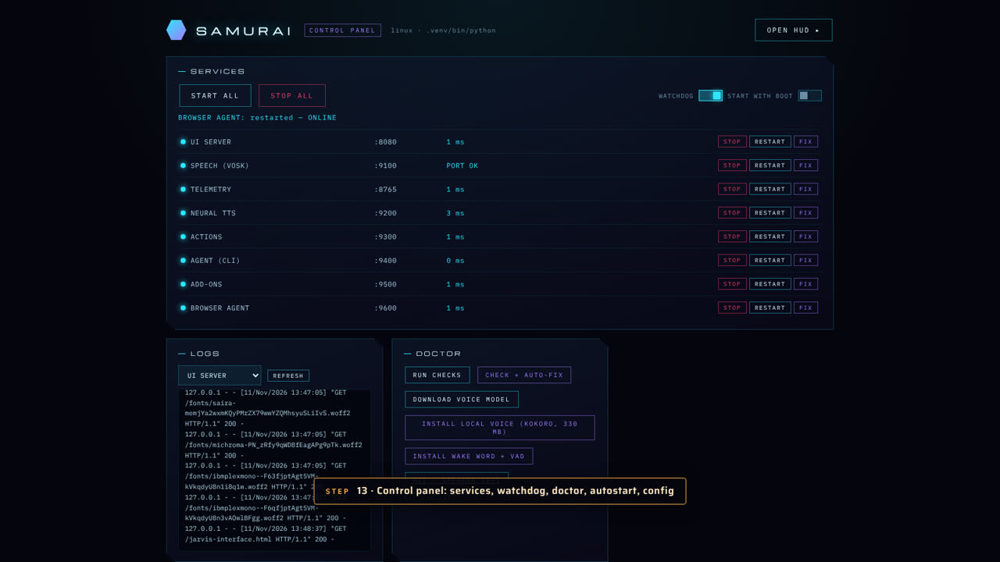

`http://localhost:9000`: every service with health and response time, start/stop/restart, logs, watchdog, start-with-boot, config editor, voice engine installers.

## 14. Doctor

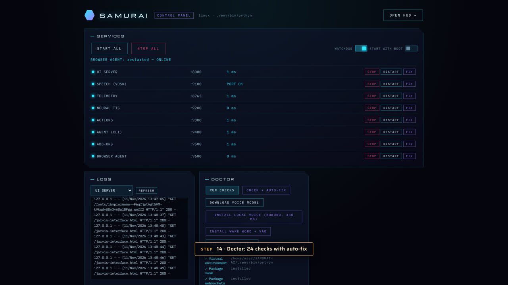

Twenty-four checks on Python, packages, the voice model, config, every service, optional tools, internet and disk, with auto-fix.

## Not in the recording

Voice input needs a microphone, so the recording types the commands. The same commands work spoken: click MIC and talk, or enable the wake word and say "samurai, …". The vision, browser agent and desktop agent features need a configured vision brain and a desktop session; they are covered in the README.
